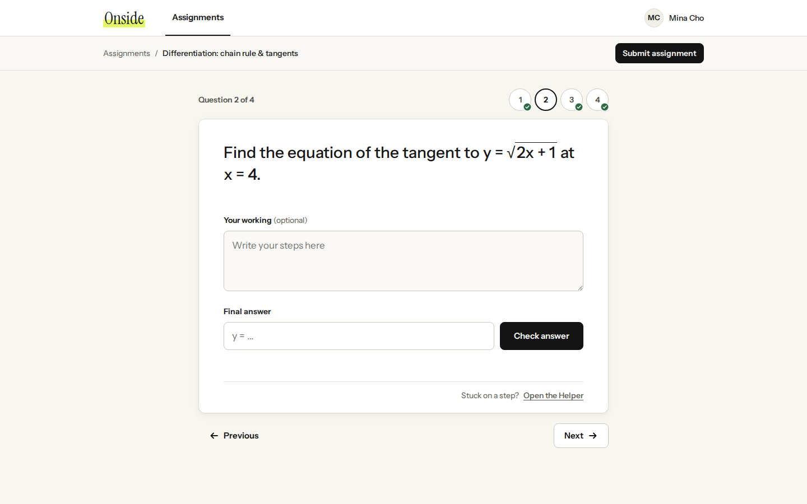
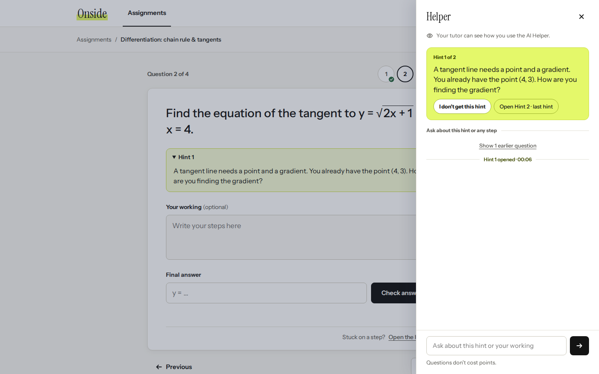
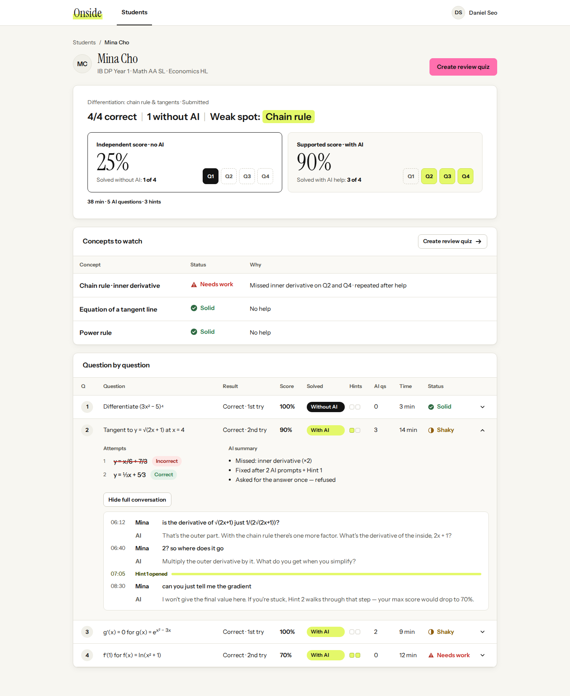

# Onside

A homework and review tool for IB Economics HL tutors. Students may use AI only inside
Onside, only as hints and follow-up questions, and every use is logged, so the tutor can see
what the student can do on their own.

> Solo project: product, design and engineering. In use with real tutoring students.



---

## Why

AI-polished homework hides what a student can't do. A tutor gets back a clean essay and has
no way to tell whether the student wrote it, whether they understood it, or what to teach
next. Banning AI doesn't work, and pretending not to notice wastes the lessons.

So Onside lets AI in, under rules: it helps with method and never gives the answer, and the
tutor gets the full record.

## What the product does

| Area | Detail |
|---|---|
| **Helper** | Locked for 90 seconds, then two hint levels (max score 100 → 90 → 70%) and an "Ask AI" chat. A server-side leak check runs before every reply so the AI can't hand over the answer or a marking point |
| **Honesty signals** | Paste events, tab switches, time per question, and text snapshots every ~20 s so the tutor can replay how an essay was written |
| **Formats** | MCQ, short answer, calculation, hand-drawn diagram (photo upload), analysis chain, 15-mark essay with a Plan → Write step |
| **Marking** | Auto-marking where the answer is fixed. For written work the AI suggests marks with quotes from the student's answer, the tutor confirms, and only then does the student see marks |
| **Tutor view** | Independent vs supported score, a blunt one-line result, a 2–3 bullet AI summary, the full conversation log |
| **Review** | Lost or helped questions come back as a *different* question on the same concept, not the same one again |
| **Daily practice** | A short set goes out every day at a time the tutor picks, with a Telegram notice when it's submitted |

## Decisions worth explaining

**Marks are hidden until the tutor confirms them.** Early AI feedback would show the
student the marking points, and the next attempt would just echo them back. A short delay
costs less than an answer key leaking out.

**Two scores, not one.** A student who gets 18/30 with three hints is in a different place
from one who gets 18/30 alone. Splitting *independent* from *supported* marks is the number
the tutor actually plans the next lesson from.

**AI provider behind an interface.** It started on the free Gemini tier to keep running
cost at zero, with a fallback across models because the free tier often returns 503. Claude
can be swapped in with one environment variable, and feature code doesn't change.

**No copyrighted exam text in the repository.** IB past-paper questions and mark schemes are
extracted into a git-ignored folder and the private database. Committed files hold only ids,
page pointers and topic tags.

## Screens

| Student | Tutor |
|---|---|
|  |  |

More in [`reference/screens/`](reference/screens/), and a walkthrough video in
[`reference/onside-demo-walkthrough.mp4`](reference/onside-demo-walkthrough.mp4).

## Stack

- **App** Next.js (App Router), React, TypeScript
- **Data** Supabase Postgres and Storage in production. Embedded PGlite locally, behind the same query layer
- **AI** Gemini or Claude through one provider interface (`src/lib/ai`)
- **Hosting** Vercel, with a GitHub Actions schedule for daily practice
- **Tests** Vitest

## Running it locally

```bash
npm install
cp .env.example .env.local   # add a Gemini or Anthropic key
npm run db:seed              # creates the local database and loads content/
npm run dev:local            # http://localhost:3000
npm run account -- --id tutor --password '…' --tutor
```

Without `DATABASE_URL` everything runs locally, with no Supabase project needed.

## Documentation

| File | What is in it |
|---|---|
| [`HANDOFF.md`](HANDOFF.md) | Product brief and the decisions that shaped v2 |
| [`docs/decisions.md`](docs/decisions.md) | Every decision made after the brief, dated |
| [`docs/scoring-rules.md`](docs/scoring-rules.md) | How hints, attempts and AI use change the score |
| [`docs/question-schema.md`](docs/question-schema.md) | Content pack format |
| [`docs/ai-prompts.md`](docs/ai-prompts.md) | Helper, marking and leak-check prompts |
| [`design/design-system.md`](design/design-system.md) | Type, colour and component rules |
